<div align="center">

# 🥛 奶系桌宠 · Milk Pets

**为 ChatGPT / Codex 工作模式制作的精细 3D 奶黄色桌宠系列**

奶蛙 · 奶鸡 · 奶鼠 ｜ 8 × 11 v2 精灵表 ｜ 透明背景 ｜ 鼠标环视

[](https://github.com/YaoSong808/milk-pets/releases/latest/download/milk-pets-complete.zip)
[](USAGE.md)

</div>

## 三步开始使用

**用 Agent 安装 Codex 桌宠：**把仓库地址发给你的 Agent，并说“帮我安装奶家生物桌宠”。仓库附带 Agent 指引和安装脚本，可自动安装三只桌宠；安装后在 Codex 的桌宠选择器中启用。支持本地自定义桌宠的 Codex 环境。

```text
帮我安装奶家生物桌宠：
https://github.com/YaoSong808/milk-pets
```

**ChatGPT Work 上传导入：**

1. 点击角色下方的 **下载完整包**，或点击上方的 **下载全部桌宠**。
2. 解压后找到对应角色的 `spritesheet.png`。
3. 在 ChatGPT / Codex 工作模式中创建自定义桌宠，并上传该精灵表。

> 完整包同时附带 `pet.json` 和简明安装说明。只想要图片时，也可以点击“仅下载精灵表”。

## 选择你的桌宠

### 🐸 奶蛙 · 原版大笑精修

保留捧肚大笑和笑后弯腰动作，并修正闭眼笑的眼睛造型。

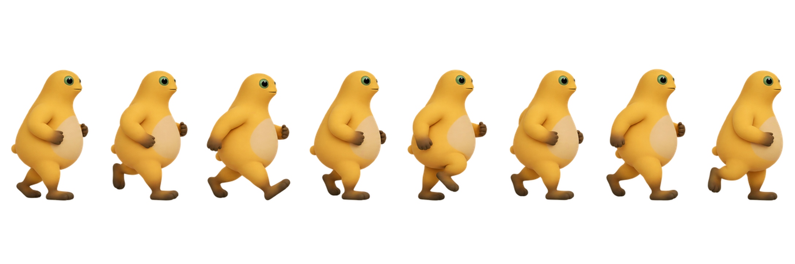

#### 动作一览

<p align="center">
  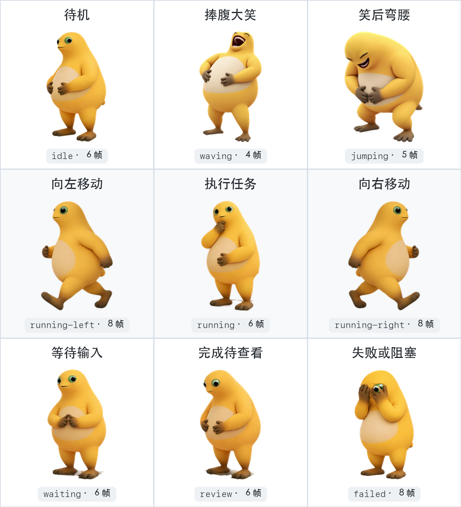
</p>

[](https://github.com/YaoSong808/milk-pets/releases/latest/download/milk-frog-v2.zip)
[](https://github.com/YaoSong808/milk-pets/raw/main/pets/naiwa/spritesheet.png)

<details>
<summary><strong>查看完整动作与鼠标环视</strong></summary>
<br>

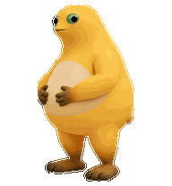

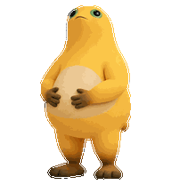

</details>

---

### 🐔 奶鸡

红色鸡冠、大扇形尾羽、浅绿色眼睛；动作由翅膀、鸡冠、尾羽和重心共同表达。

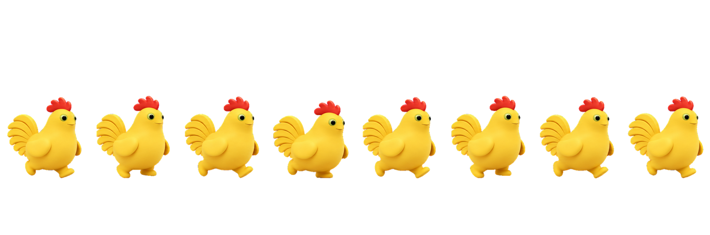

#### 动作一览

<p align="center">
  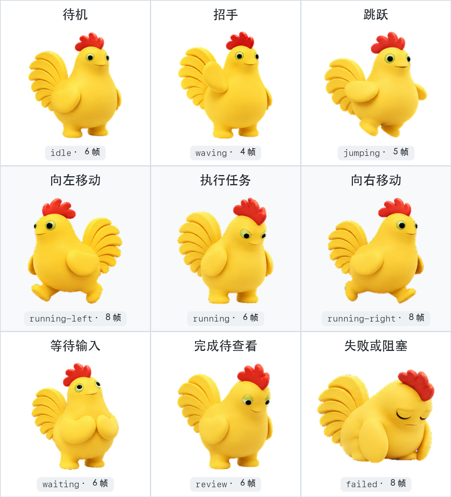
</p>

[](https://github.com/YaoSong808/milk-pets/releases/latest/download/milk-chicken-v2.zip)
[](https://github.com/YaoSong808/milk-pets/raw/main/pets/naiji/spritesheet.png)

<details>
<summary><strong>查看完整动作与鼠标环视</strong></summary>
<br>

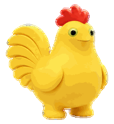

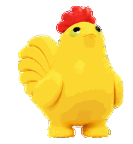

</details>

---

### 🐭 奶鼠

超大圆耳、橙色内耳、浅绿色眼睛和细长尾巴；动作由耳朵、短手、尾巴和眼神共同表达。

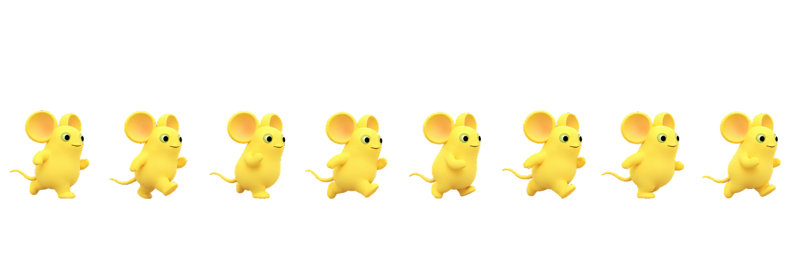

#### 动作一览

<p align="center">
  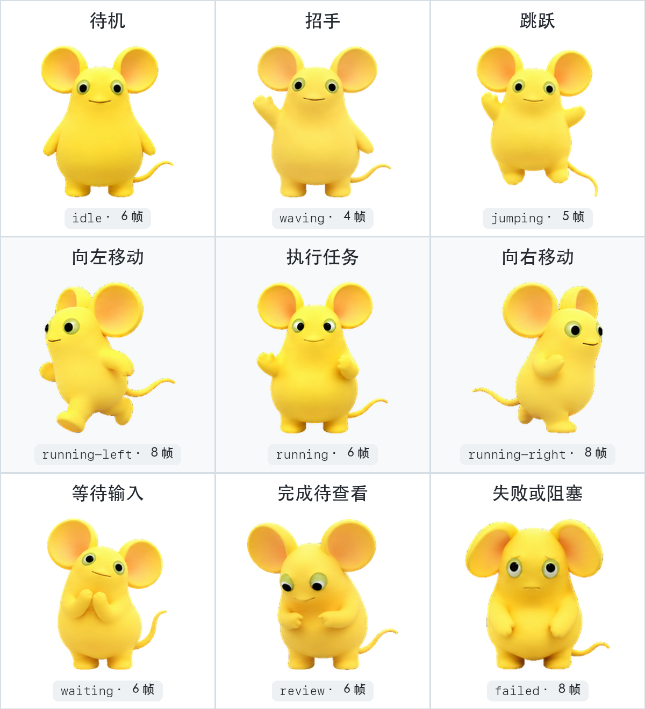
</p>

[](https://github.com/YaoSong808/milk-pets/releases/latest/download/milk-mouse-v2.zip)
[](https://github.com/YaoSong808/milk-pets/raw/main/pets/naishu/spritesheet.png)

<details>
<summary><strong>查看完整动作与鼠标环视</strong></summary>
<br>

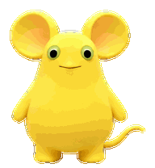

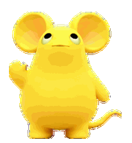

</details>

## 精灵表规格

| 项目 | 规格 |
| --- | --- |
| 版本 | v2 |
| 画布 | `1536 × 2288` |
| 网格 | 8 列 × 11 行 |
| 单格 | `192 × 208` |
| 图像 | 透明 PNG |
| 动作 | 待机、左右移动、挥手、跳跃、失败、等待、工作、检查 |
| 交互 | 16 个方向的鼠标环视 |

每个角色目录包含最终 `spritesheet.png`、角色信息 `pet.json`、GitHub 展示长图、动作预览和质量检查结果。

## 质量检查

奶鸡和奶鼠均完成 73 个必需帧与 15 个透明空格校验、跳跃基线检查、16 向环视连续性检查、三位独立审查者随机方向盲测，以及 ChatGPT Pets 上传前结构校验。

## 开发者：重新导出预览

需要 Python 3 和 Pillow：

```bash
python tools/render_previews.py pets/naiji/spritesheet.png pets/naiji/previews
python tools/make_showcase_strip.py pets/naiji/spritesheet.png pets/naiji/showcase-strip.png
python tools/make_action_overview.py pets/naiji/spritesheet.png pets/naiji/action-overview.png
```

## 使用说明

本仓库暂未附带开源许可证。下载桌宠并不自动授予素材二次分发或商业使用权。
